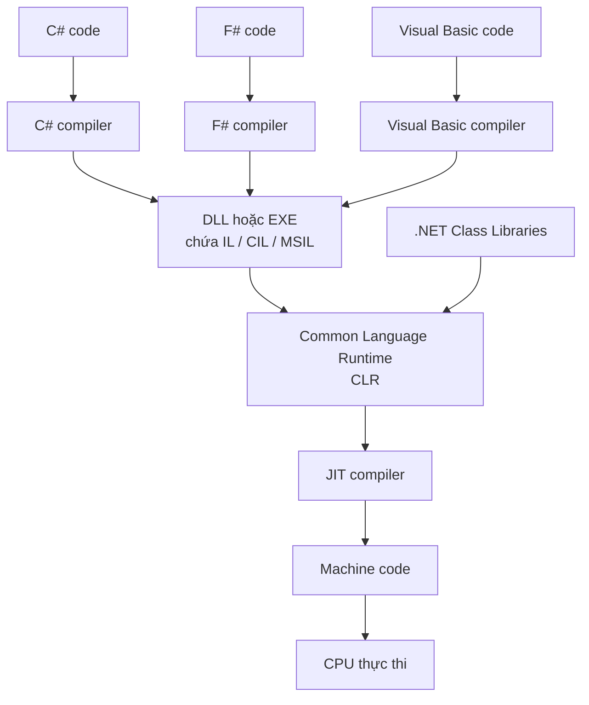

# Kiến trúc biên dịch và thực thi trong .NET

## Flowchart đơn giản



## Đọc flowchart từ trên xuống dưới

### Bước 1: Source code

Có thể dùng nhiều ngôn ngữ trong hệ sinh thái .NET:

- C# code.
- F# code.
- Visual Basic code.

### Bước 2: Compiler tương ứng

Mỗi ngôn ngữ có compiler riêng:

```text
C#             → C# compiler
F#             → F# compiler
Visual Basic   → Visual Basic compiler
```

Compiler đọc source code và chuyển nó thành code trung gian.

### Bước 3: DLL hoặc EXE chứa IL

Các compiler tạo ra assembly dạng DLL hoặc EXE. Bên trong có IL, còn gọi là CIL hoặc MSIL trong tài liệu cũ.

IL là code trung gian, chưa phải machine code mà CPU thực thi trực tiếp.

### Bước 4: CLR

CLR, viết tắt của Common Language Runtime, **không tạo thêm một bản IL và cũng không phải là một file chứa IL mới**. CLR chỉ mở, nạp và đọc IL đang nằm bên trong DLL hoặc EXE, sau đó quản lý quá trình chạy.

Hãy hình dung:

```text
DLL/EXE = chiếc hộp đã chứa IL
CLR     = người mở hộp và điều phối cách chạy IL
```

Vì vậy, đoạn này:

```text
DLL/EXE chứa IL  →  CLR
```

có nghĩa là **CLR nhận và đọc IL từ DLL/EXE**, không có nghĩa là CLR lại chứa thêm IL.

`.NET Class Libraries` cũng được CLR sử dụng để cung cấp các chức năng có sẵn như string, collection, file, date/time và networking.

### Bước 5: JIT compiler

JIT là viết tắt của Just-In-Time. JIT chuyển IL thành machine code phù hợp với máy tại thời điểm chạy.

### Bước 6: Machine code và CPU

Machine code là dạng code mà CPU có thể thực thi. CPU thực hiện machine code để chương trình hoạt động.

## Những thành phần nằm bên trong CLR

Các thành phần sau thuộc CLR nhưng không cần đưa vào flowchart chính:

| Thành phần | Vai trò |
|---|---|
| Class Loader | Nạp class và assembly |
| JIT Compiler | Chuyển IL thành machine code |
| Code Manager | Quản lý code trong lúc chạy |
| Garbage Collector | Tự dọn bộ nhớ không còn dùng |
| Exception Handler | Hỗ trợ xử lý exception |
| Security | Hỗ trợ cơ chế an toàn |

## Tóm tắt một dòng

```text
C# / F# / VB → Compiler → IL trong DLL/EXE → CLR → JIT → Machine code → CPU
```

## Câu trả lời phỏng vấn

> Các ngôn ngữ C#, F# và Visual Basic được compiler tương ứng chuyển thành IL và đóng gói trong DLL hoặc EXE. Khi chạy, CLR nạp IL, JIT chuyển IL thành machine code, sau đó CPU thực thi machine code. CLR đồng thời cung cấp các dịch vụ như quản lý bộ nhớ và xử lý exception.

